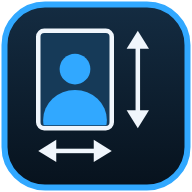
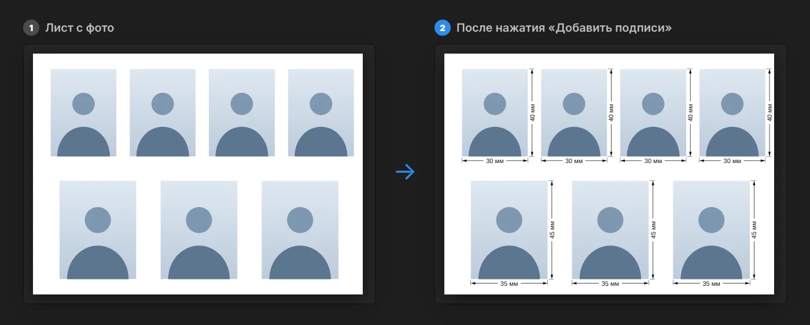
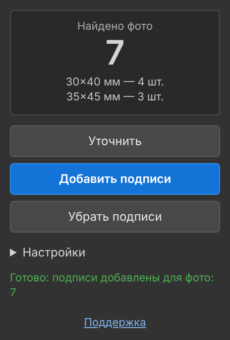
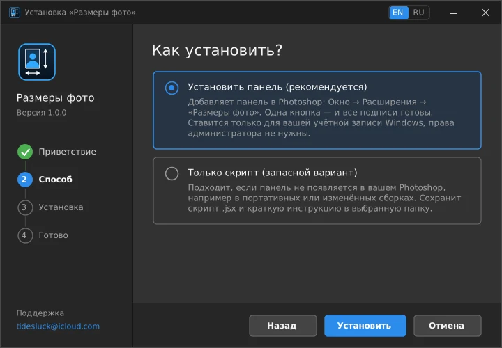

<div align="center">



# Размеры фото

**Подписи размеров фото в Photoshop одной кнопкой**

Панель и скрипт для Adobe Photoshop: сами находят все фото на листе, считают размер в миллиметрах<br>и рисуют размерные стрелки с подписями. Подписи остаются частью растра.

<br>

[](https://github.com/T1desLuck/PhotoSizeLabels/raw/main/PhotoSizeLabelsSetup.exe)

[Сайт](https://t1desluck.github.io/PhotoSizeLabels/) · [English](https://t1desluck.github.io/PhotoSizeLabels/en/) · [Панель .zip](https://github.com/T1desLuck/PhotoSizeLabels/raw/main/PhotoSizeLabels_panel.zip) · [Скрипт .jsx](photo_size_labels.jsx) · [Поддержка](mailto:tidesluck@icloud.com)


[](LICENSE)

</div>

<br>



<sub>Иллюстрация результата: на листе с фото разных размеров у каждого появляются высота сбоку и ширина снизу.</sub>

## Зачем это нужно

На листе с фото на документы размеры принято подписывать: так клиент и печатник видят, что формат выдержан. Вручную это десятки линий и цифр, и каждый раз заново, если фото сдвинули.

Панель делает это сама. Она берёт слои с фото, меряет их по реальным границам, переводит в миллиметры по разрешению документа и рисует чертёжные подписи: стрелки, выносные линии и цифры. Размер фото может быть любым: 3×4, 3,5×4,5, 9×12, 10×15 или нестандартный.

## Возможности

- **Любой размер.** Ничего вводить не нужно, размер считается по самому слою.
- **Высота и ширина у каждого фото.** Высота сбоку, ширина снизу. У края листа подпись сама переходит на другую сторону.
- **Часть растра.** Всё лежит в группе слоёв «Размеры». После сохранения в JPG или PNG подписи остаются на картинке.
- **Один шаг истории.** Отмена по `Ctrl+Z`. Повторный запуск стирает старые подписи и рисует новые, поэтому фото можно двигать.
- **Настройки.** Высота цифр, расстояние до фото, толщина линий, сторона подписи, режим подписи ширины. Значения запоминаются.
- **Без облака и аккаунта.** Работает офлайн, Adobe Creative Cloud и вход в учётную запись не нужны.

<div align="center">

</div>

## Скачать

| Вариант | Для кого | Файл |
|---|---|---|
| **Установщик** (рекомендуется) | Windows 10 и 11, самый простой путь | [`PhotoSizeLabelsSetup.exe`](https://github.com/T1desLuck/PhotoSizeLabels/raw/main/PhotoSizeLabelsSetup.exe) |
| **Панель вручную** | Mac или ручная установка | [`PhotoSizeLabels_panel.zip`](https://github.com/T1desLuck/PhotoSizeLabels/raw/main/PhotoSizeLabels_panel.zip) |
| **Только скрипт** | Сборки Photoshop без поддержки панелей | [`photo_size_labels.jsx`](photo_size_labels.jsx) (на странице файла кнопка *Download raw file*) |

Все три варианта делают одно и то же. Различается только способ запуска.

## Установка

### Установщик (Windows)

1. Скачайте и запустите `PhotoSizeLabelsSetup.exe`. Язык выбирается по Windows, переключатель EN | RU в углу окна.
2. Выберите «Установить панель» и нажмите «Установить». Права администратора не нужны, всё ставится в вашу учётную запись.
3. Полностью закройте Photoshop и запустите заново.
4. Откройте панель: **Окно → Расширения → Размеры фото**. Её можно перетащить к остальным панелям справа, Photoshop запомнит место.

<details>
<summary>Windows показывает «Windows защитила ваш компьютер»</summary>

У файла нет платной цифровой подписи, поэтому SmartScreen предупреждает о неизвестном издателе. Нажмите **Подробнее**, затем **Выполнить в любом случае**. Установщик работает только в вашей учётной записи и ничего в системе не меняет. Некоторые антивирусы могут так же реагировать на любые неподписанные установщики.
</details>

<div align="center">

</div>

Установщик делает три вещи: копирует панель в `%APPDATA%\Adobe\CEP\extensions\PhotoSizeLabels`, разрешает Photoshop загружать панели без цифровой подписи (параметр `PlayerDebugMode` для текущего пользователя) и добавляет запись в «Приложения» для удаления.

### Вручную

Скачайте [`PhotoSizeLabels_panel.zip`](https://github.com/T1desLuck/PhotoSizeLabels/raw/main/PhotoSizeLabels_panel.zip), закройте Photoshop.

**Windows**

1. Скопируйте папку `PhotoSizeLabels` из архива в `%APPDATA%\Adobe\CEP\extensions` (вставьте путь в адресную строку Проводника; если папок `CEP` и `extensions` нет, создайте их).
2. Разрешите панели без подписи. Нажмите `Win+R`, введите `cmd`, вставьте и нажмите Enter:

   ```bat
   for %V in (6 7 8 9 10 11 12 13) do reg add "HKCU\Software\Adobe\CSXS.%V" /v PlayerDebugMode /t REG_SZ /d 1 /f
   ```

**macOS**

1. Скопируйте папку `PhotoSizeLabels` в `~/Library/Application Support/Adobe/CEP/extensions`.
2. В Терминале выполните:

   ```bash
   for v in 6 7 8 9 10 11 12 13; do defaults write com.adobe.CSXS.$v PlayerDebugMode 1; done
   ```

Запустите Photoshop: **Окно → Расширения → Размеры фото**.

### Только скрипт

1. Скачайте `photo_size_labels.jsx` (или выберите «Только скрипт» в установщике: он сохранит файл и инструкцию в выбранную папку).
2. В Photoshop откройте шаблон и выполните **Файл → Сценарии → Обзор…**, выберите `photo_size_labels.jsx`.

Чтобы запускать одной кнопкой: **Окно → Операции** → создайте операцию и включите запись → запустите скрипт через «Файл → Сценарии» → остановите запись → в меню панели «Операции» включите «Режим кнопки».

## Как пользоваться

1. Откройте шаблон: внизу фоновый слой листа, поверх него слои с фото.
2. Нажмите **Уточнить**. Вверху панели появится число найденных фото и их размеры.
3. Нажмите **Добавить подписи**. Повторное нажатие пересчитывает всё заново.
4. **Убрать подписи** удаляет группу «Размеры». Для чистого листа группу можно просто скрыть глазком.

**Что подписывается.** Все видимые слои выше нижнего (фонового), включая слои внутри групп.

**Что пропускается.** Нижний слой, слои на весь лист, текстовые и корректирующие слои, слои меньше 5 мм, а также любой слой, имя которого начинается с `_`. Это удобный способ исключить слой вручную.

> [!IMPORTANT]
> Размеры считаются по разрешению документа (пикселей на дюйм). В шаблоне должно быть указано верное разрешение, например 300 пикс/дюйм. Иначе миллиметры не совпадут с реальными.

### Настройки панели

| Параметр | По умолчанию | Описание |
|---|---|---|
| Высота цифр, мм | 1,5 | Чем меньше число, тем мельче подпись |
| Расстояние до фото, мм | 1,3 | Отступ размерной линии от края фото |
| Толщина линий, мм | 0,15 | Толщина стрелок и размерных линий |
| Подпись высоты | справа | Справа или слева от фото |
| Подпись ширины | у каждого фото | Либо только у нижнего фото в колонке |

Кнопка «Сбросить настройки» возвращает значения по умолчанию.

### Настройки скрипта

Откройте `photo_size_labels.jsx` в Блокноте. В начале файла есть блок `НАСТРОЙКИ` (`CFG`). Меняйте только числа и слова в кавычках.

| Параметр | По умолчанию | Описание |
|---|---|---|
| `textHeightMM` | `1.5` | Высота цифр, мм |
| `offsetMM` | `1.3` | Расстояние до фото, мм |
| `lineMM` | `0.15` | Толщина размерной линии, мм |
| `heightSide` | `'right'` | `'right'` или `'left'` |
| `widthOn` | `'all'` | `'all'`, `'bottom'` (не писать, если ниже фото той же ширины) или `'none'` |
| `minSizeMM` | `5` | Слои меньше этого размера игнорируются |
| `skipPrefix` | `'_'` | Слои с таким началом имени игнорируются |
| `unitText` | `'мм'` | Подпись единицы, например `'mm'` (хранится в `\u`-кодах) |

## Если что-то не работает

<details>
<summary>Панели нет в меню «Расширения»</summary>

- Photoshop нужно закрыть полностью и запустить заново (проверьте диспетчер задач).
- Убедитесь, что установка или команда регистрации завершились без ошибок.
- В некоторых портативных и переупакованных сборках Photoshop поддержка панелей вырезана или отключена. Используйте скрипт `photo_size_labels.jsx`: он делает то же самое, но без панели.
</details>

<details>
<summary>Панель пишет «Нет открытого документа» или «Нет слоёв для подписи»</summary>

Откройте документ с несколькими слоями: фон внизу, фото сверху. Слои с именем на `_`, текстовые и слишком крупные (на весь лист) не учитываются.
</details>

<details>
<summary>Миллиметры не совпадают с реальными</summary>

Проверьте разрешение документа: **Изображение → Размер изображения**. Размеры считаются из него, для печати обычно нужно 300 пикс/дюйм.
</details>

<details>
<summary>Не появляются подписи у некоторых фото</summary>

Нажмите «Уточнить» и посмотрите, сколько слоёв найдено. Слои меньше 5 мм, текстовые, корректирующие, скрытые и с именем на `_` пропускаются. Дубли на одном месте (например, рамка и фото) считаются за одно.
</details>

## Удаление

- **Установщик:** запустите `PhotoSizeLabelsSetup.exe` ещё раз и выберите «Удалить программу» либо откройте **Параметры → Приложения** и удалите «Photo Size Labels (Размеры фото)». Режим непроверенных панелей по умолчанию остаётся (он может быть нужен другим панелям), в установщике есть галочка, чтобы отключить и его.
- **Вручную:** закройте Photoshop и удалите папку `PhotoSizeLabels` из папки `extensions` (пути указаны выше).
- **Скрипт:** удалите файл `photo_size_labels.jsx`.

## Совместимость

| | Поддержка |
|---|---|
| Photoshop | CC 2015 и новее (панель), скрипт работает везде, где есть «Файл → Сценарии» |
| Windows | 10 и 11 (установщику нужен .NET Framework 4.5+, он уже встроен) |
| macOS | ручная установка по инструкции выше; на реальном Mac пока не проверялась |
| Язык | установщик на русском и английском; кнопки панели и единица «мм» на русском |

## Как это устроено

Панель написана на HTML и JavaScript (технология CEP) и вызывает скрипт ExtendScript внутри Photoshop. Скрипт собирает видимые слои, берёт их границы, переводит пиксели в миллиметры по разрешению документа и рисует стрелки заливкой выделений, а цифры текстовыми слоями. Размер шрифта подбирается замером результата, поэтому не зависит от единиц шрифта в Photoshop. Всё собирается в одну группу слоёв и один шаг истории. Исходный текст панели и скрипта открыт для чтения в этом репозитории.

## Состав репозитория

```text
PhotoSizeLabelsSetup.exe       установщик (Windows)
PhotoSizeLabels_panel.zip      панель + инструкция + скрипт одним архивом
PhotoSizeLabels/               папка панели (CSXS, index.html, js, jsx)
photo_size_labels.jsx          отдельный скрипт
docs/                          сайт (GitHub Pages)
LICENSE                        лицензия
```

## Поддержка

Вопросы, баги и пожелания: [tidesluck@icloud.com](mailto:tidesluck@icloud.com) или кнопка «Поддержка» в панели. Ещё можно открыть [Issue](https://github.com/T1desLuck/PhotoSizeLabels/issues). В письме укажите версию Photoshop и приложите скриншот панели.

## Лицензия

Использовать бесплатно, в том числе в коммерческой работе, можно. **Распространять, перепродавать, пересобирать и выкладывать копии нельзя.** Вместо этого делитесь ссылкой на этот репозиторий. Полный текст на русском и английском: [LICENSE](LICENSE).

---

<sub>© 2026 T1desLuck. Независимый инструмент, не связан с Adobe и не одобрен ею. Adobe и Photoshop являются товарными знаками Adobe Inc.</sub>
